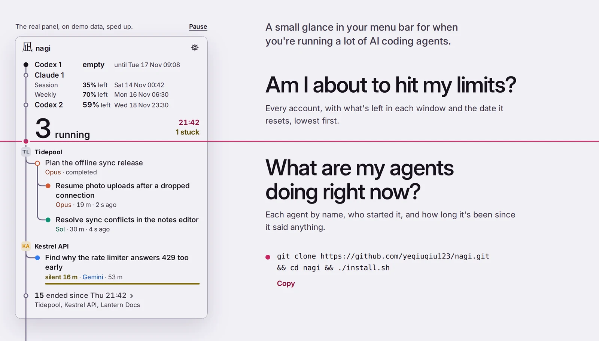

<p align="center">
  <picture>
    <source media="(prefers-color-scheme: dark)" srcset=".github/assets/mark-dark.svg">
    
  </picture>
</p>

<h1 align="center">Nagi</h1>

<p align="center">
  A small glance in your menu bar for when you're running a lot of AI coding agents.<br>
  <a href="https://usenagi.xyz"><b>usenagi.xyz</b></a> · <a href="#install">Install</a> · <a href="CONTRIBUTING.md">Write an adapter</a>
</p>

<p align="center">
  <picture>
    <source media="(prefers-color-scheme: dark)" srcset=".github/assets/nagi-dark.webp">
    
  </picture>
</p>

Nagi answers two questions:

- **Am I about to hit my limits?** Every account, with what's left in each window and the date it resets, lowest first. A notification when a window runs low.
- **What are my agents doing right now?** Each agent by name, who started it, and how long it's been since it said anything. Closed, it's just a number in your menu bar or tray.

Two more, if you want them:

- **Your branches on GitHub.** Each agent's branch shows its checks and its latest deployment as a small mark, and pull requests waiting on you are counted beside the agents that ask you. It's off until you switch it on in Settings → Sources, and it only reads.
- **Three themes.** Violet, Graphite and Tide, each light and dark, with your own colour for the accent and for each provider. A colour you pick is adjusted until it reads well on both, and one that would look like a warning isn't taken.

It runs on **Linux** (a GTK tray) and **macOS** (a menu-bar app).

## Sources

| App | How Nagi reads it | Where |
|---|---|---|
| **T3 Code** | T3's own read-only connection | This computer, or another one over your Tailscale |
| **Claude Code** | Small hooks that note when a session starts and stops. For limits, your sign-in, sent only to Anthropic | This computer |
| **Codex** | The session logs Codex keeps. For limits, with your consent, your sign-in, sent only to OpenAI | This computer |
| **Cursor** (beta) | Small hooks for activity. For the monthly limit, your sign-in, sent only to Cursor | This computer |

**Coming soon:** OpenBot, Pi, oh-my-pi, Hermes, OpenClaw and OpenCode. Each needs only a small adapter; see [CONTRIBUTING.md](CONTRIBUTING.md).

## Install

```sh
git clone https://github.com/yeqiuqiu123/nagi.git && cd nagi && ./install.sh
```

You need Python 3.11 or newer. On Linux, Nagi also needs GTK 3, WebKitGTK 4.1 and an AppIndicator tray; on a Mac, Swift from Xcode or the Command Line Tools. The installer checks and tells you what's missing.

It sets up Nagi's reader in your home folder, starts it with your desktop and opens Nagi, which walks you through connecting your agent apps. Run it again any time: it keeps your data, owner key and connections, and asks before it uses sudo. `./install.sh --no-launch` installs without opening Nagi.

On Linux, Nagi starts with your desktop session and restarts if it crashes; **Quit Nagi** keeps it closed until your next login. On X11 one click on 凪 opens the panel; elsewhere 凪 opens a menu with **Open Nagi**.

On a Mac, `mac/setup-mac.sh` does the whole install: it builds `~/Applications/Nagi.app`
(a menu-bar extra), starts the reader LaunchAgent, writes the T3 policy and adds a
launch-at-login agent. `--t3-origin http://<tailnet 100.x>:3773` reads another
machine's T3 over Tailscale (pipe its read-only token in with `--token-stdin`);
`--t3-local` pairs with the Mac's own T3 Code. `mac/test.sh` runs the Swift tests;
`mac/uninstall-mac.sh` removes it all.

## Terminal status

`install.sh` installs `nagi` in `~/.local/bin`. If your shell cannot find it,
add that directory to your PATH. Try `nagi status` in a shell prompt or tmux.
Use `nagi status --json` for the full summary, including machine load, or
`nagi status --waybar` for a Waybar custom module with `"return-type": "json"`.
`nagi status --quiet` prints nothing and exits 0 when clear, 1 for an alert,
or 2 when the status is unknown. A reader it cannot reach shows `nagi ?`.

GitHub CI is opt-in and uses your existing `gh` sign-in for read-only GitHub
requests. Once enabled, terminal status includes CI failures in watched
repositories.

## Private by design

- **Read-only.** Nagi can't stop, send to or approve anything in an agent app.
- **Local.** No cloud, no account, no telemetry. The reader listens only on 127.0.0.1 and answers only you: every request needs an owner proof or a short-lived session, and there are no cookies.
- **Honest.** When it can't read something, it says "couldn't check" with the time it tried, never a 0.
- **Nothing private leaves.** Prompts, transcripts, credentials and tool output never enter a response, a log or the journal.

## Development

Standard library only, Python 3.11+.

```sh
python3 -B -m pytest tests -q   # isolates HOME and blocks the network
node --test tests/*.test.cjs
mac/test.sh                     # on a Mac
```

How the reader, its owner check and notifications work: [design/reader.md](design/reader.md). The website is in [`site/`](site/README.md) and runs the real panel on invented data.

## Licence

[MIT](LICENSE). Bundled fonts and icons keep their own licences: Inter and the Noto 凪
subset (SIL OFL 1.1, `web/fonts/`), Lucide icon data (ISC, `web/lucide-LICENSE.txt`),
T3 Code's theme colours (MIT, `web/T3-THEME-LICENSE.txt`) and GitHub's reserved route names
from Mottie/github-reserved-names (MIT, `web/github-reserved-names-LICENSE.txt`).
